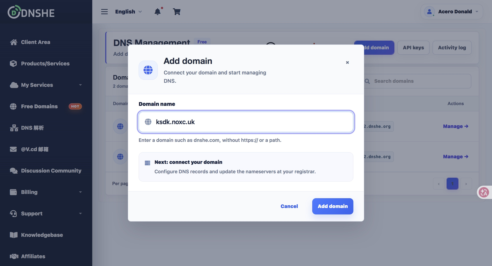
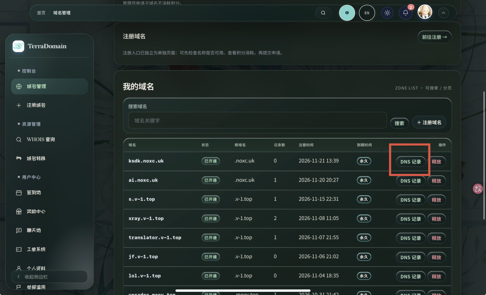
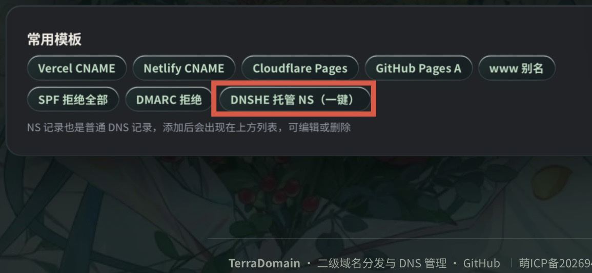
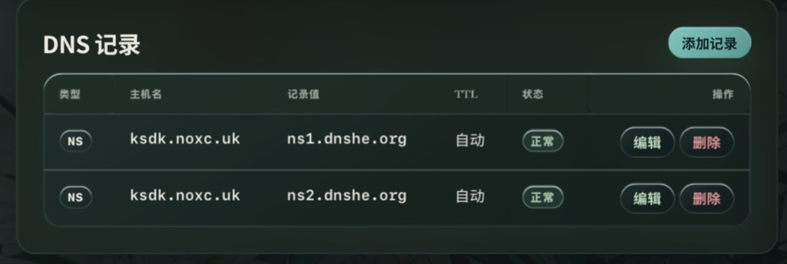
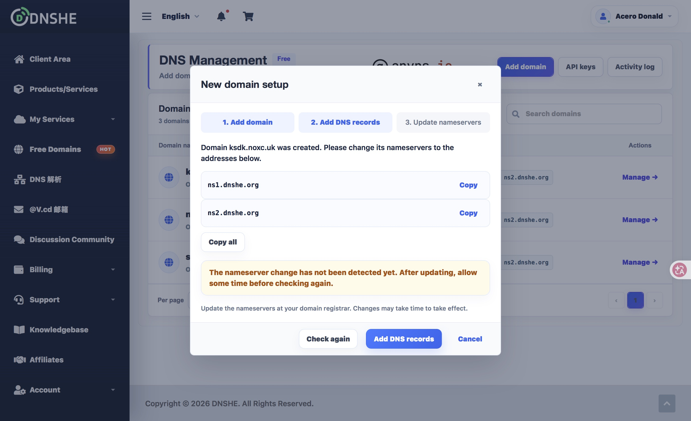
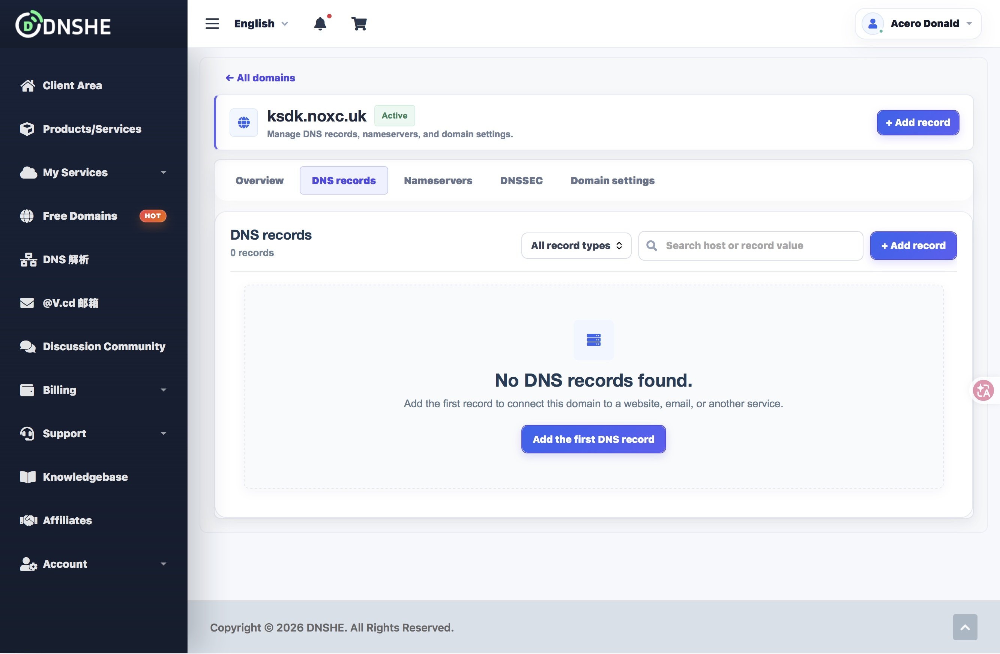

# DNSHE 托管接入

本章按控制台截图实写。若 DNSHE 界面后续更新，以实际页面为准。

## 图 1 · 登录 DNSHE

打开 DNSHE 控制台并登录账号。

## 图 2 · 域名列表

找到要托管的域名，进入域名管理。

## 图 3 · 域名概览

确认域名状态与当前 NS。

## 图 4 · 进入 DNS 管理

切到 DNS 记录 / 域名服务器相关设置。

## 图 5 · NS 记录就是 DNS 记录

NS 记录出现在普通记录列表里，可编辑或删除。

## 图 6 · 写入托管 NS

外部域名托管使用 `ns1.dnshe.org`、`ns2.dnshe.org`。

::: tip 别写错
`ns1.dnshe.com` / `ns2.dnshe.com` 只给**在 DNSHE 注册的域名**用；`api005.dnshe.com` 是 API 网关，不是 NS 主机。
:::

## 图 7 · 新建区域后的引导弹窗

弹窗底部有三个按钮，**只有中间蓝色的 `Add DNS records` 会进入图 8**：

| 按钮 | 作用 |
|---|---|
| `Check again` | 只原地刷新黄色提示，不跳转 |
| **`Add DNS records`** | **进入 DNS records 页（图 8）** |
| `Cancel` | 直接退出引导 |

这一步最容易走错，一定要点 `Add DNS records`。

## 图 8 · DNS records 页

显示「0 records / No DNS records found.」是**新建区域的正常状态**，不是报错。在这里开始添加记录即可。
